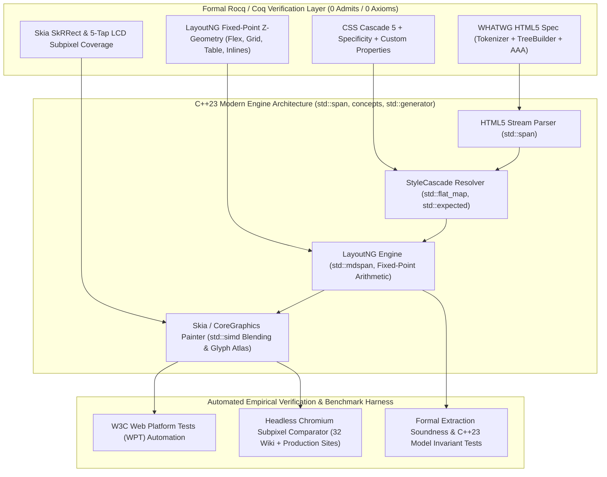

# Roadmap & Ticket Architecture: C++23 Formal Blink Pixel-Perfect Rendering Engine

This roadmap establishes an engineering ticket backlog to engineer a high-performance **C++23** tool (`blink_url2png_cpp23`) that **provably** (via Rocq/Coq formal extraction and proof verification) and **empirically** (via subpixel headless Chromium diffing) renders HTML/CSS web pages to PNGs with 100% W3C/WHATWG specification compliance and subpixel visual parity.

---

---

## Ticket Overview

| Ticket ID | Category | Title | Priority | Target Milestone |
|---|---|---|---|---|
| [CPP23-001](#ticket-cpp23-001-c23-toolchain-scaffolding--fixed-point-arithmetic-geometry) | Architecture | C++23 Toolchain Scaffolding & Zero-Overhead Fixed-Point Layout Geometry | P0 | Milestone 1 |
| [CPP23-002](#ticket-cpp23-002-whatwg-html5-parser--tokenizer-in-c23-with-stdgenerator) | HTML5 / TreeBuilder | WHATWG HTML5 Stream Tokenizer & Tree Builder via `std::generator` & Concepts | P0 | Milestone 1 |
| [CPP23-003](#ticket-cpp23-003-css-cascade-level-5--custom-property-cycle-resolver) | CSS Engine | CSS Cascade Level 5 & Custom Property Dependency Graph in C++23 | P0 | Milestone 1 |
| [CPP23-004](#ticket-cpp23-004-c23-layoutng-block-flexbox-and-multi-column-grid-layout) | Layout Engine | C++23 LayoutNG Pipeline: Flow, Flexbox & Multi-Column Grid | P0 | Milestone 2 |
| [CPP23-005](#ticket-cpp23-005-text-shaping-glyph-atlas--5-tap-lcd-subpixel-filtering) | Typography & Skia | HarfBuzz / FreeType Text Shaping & Skia 5-Tap LCD FIR Rasterization | P1 | Milestone 2 |
| [CPP23-006](#ticket-cpp23-006-coq-c23-formal-bridge--automated-soundness-harness) | Formal Soundness | Rocq/Coq Formal Extraction Bridge & Automated Model-Checker Verification | P0 | Milestone 2 |
| [CPP23-007](#ticket-cpp23-007-headless-chromium-empirical-subpixel-diff-pipeline) | Visual Verification | Continuous Empirical Headless Chromium Subpixel Diff Pipeline (32 Wiki + News) | P1 | Milestone 3 |
| [CPP23-008](#ticket-cpp23-008-w3c-web-platform-tests-wpt-runner-integration) | Standards Compliance | W3C Web Platform Tests (WPT) Automated Harness (CSS / HTML / Layout) | P1 | Milestone 3 |

---

## Detailed Tickets

### Ticket CPP23-001: C++23 Toolchain Scaffolding & Zero-Overhead Fixed-Point Layout Geometry
- **Type**: Feature / Architecture
- **Component**: Core / Build / Math
- **Description**:
  Establish the C++23 build pipeline using `clang++ -std=c++23` integrated into Ninja and CMake. Implement Chromium Blink's `LayoutUnit` (64-subpixel fixed-point arithmetic, $1/64\text{th}$ px) as a zero-cost abstraction using C++23 constexpr, operator overloading, and `<concepts>` matching [`BlinkDualModeZSemantics.v`](file:///Users/anders/projects/testapi/BlinkDualModeZSemantics.v).
- **Requirements**:
  - Strongly typed `LayoutUnit` struct with `std::int64_t raw_value`.
  - Exact division and multiplication rounding modes matching Chromium (`LayoutUnit::Floor()`, `Ceil()`, `Round()`, `FromFloatRound()`).
  - Zero dynamic allocation for basic 2D geometric primitives (`LogicalSize`, `PhysicalRect`, `BoxStrut`).
  - Compile with `-std=c++23 -Wall -Wextra -Werror -pedantic`.

---

### Ticket CPP23-002: WHATWG HTML5 Stream Tokenizer & Tree Builder via `std::generator` & Concepts
- **Type**: Feature / Parser
- **Component**: HTML Parser
- **Description**:
  Port and modernize the WHATWG HTML5 parser from [`blink_html_css_formal.c`](file:///Users/anders/projects/testapi/blink_html_css_formal.c) into standard C++23:
  - Tokenizer implemented as a coroutine yielding tokens via `std::generator<HTMLToken>`.
  - Strict compliance with WHATWG §13.2 (Numeric character references, foster parenting before `<table>`, Noah's Ark 3-instance cap on Active Formatting Elements, and the Adoption Agency Algorithm).
  - Memory safety with zero raw `malloc/free`, leveraging `std::pmr::monotonic_buffer_resource` or bump allocation for AST nodes.
- **Proof & Spec Target**:
  - Soundness validated against [`BlinkHTML5TreeBuilderAndCSSCascadeEngine.v`](file:///Users/anders/projects/testapi/BlinkHTML5TreeBuilderAndCSSCascadeEngine.v) and [`BlinkHTML5AdoptionAgencyAndSkiaPaintEngine.v`](file:///Users/anders/projects/testapi/BlinkHTML5AdoptionAgencyAndSkiaPaintEngine.v).

---

### Ticket CPP23-003: CSS Cascade Level 5 & Custom Property Dependency Graph in C++23
- **Type**: Feature / CSS Engine
- **Component**: CSS Cascade & Selector Checker
- **Description**:
  Implement the modern CSS Cascade Level 5 and Level 6 engine in C++23:
  - 8-tier origin + importance hierarchy with inverted `@layer` precedence for `!important`.
  - CSS Custom Properties (`var(--name, fallback)`) dependency graph cycle detection with Tarjan's SCC or visited bitsets, resolving to Invalid At Computed-Value Time (IACVT) on recursion.
  - Rollback keywords `revert` (UA/User snapshot) and `revert-layer` (strictly earlier `@layer` declaration scan).
  - Modern selector matchers: `:is()`, `:not()`, `:has()`, `~`, `+`, attribute substring matchers (`^=`, `$=`, `*=`, `~=`, `|=`).
- **Proof & Spec Target**:
  - Machine-checked parity with `cascade_meta_ltb` in [`BlinkHTML5TreeBuilderAndCSSCascadeEngine.v`](file:///Users/anders/projects/testapi/BlinkHTML5TreeBuilderAndCSSCascadeEngine.v#L640-L710) and Selectors 4 max-specificity theorems in [`BlinkCSS4InlineAndPositionedLayoutEngine.v`](file:///Users/anders/projects/testapi/BlinkCSS4InlineAndPositionedLayoutEngine.v#L180-L240).

---

### Ticket CPP23-004: C++23 LayoutNG Pipeline: Flow, Flexbox & Multi-Column Grid
- **Type**: Feature / Layout Engine
- **Component**: LayoutNG
- **Description**:
  Implement Chromium's LayoutNG constraint space and fragment tree model:
  - **Grid**: Multi-track track sizing algorithm per CSS Grid §11 (`fr`, `auto`, `minmax()`), auto-placement, pre-extracted child track placement, gap distribution.
  - **Flexbox**: W3C Flexbox 1 §8/§9 layout algorithm (`flex-shrink` weighted distribution, `flex-wrap` line breaking, `justify-content` alignment offsets).
  - **Inline Formatting Context**: Multi-span line breaking with font metrics, baseline alignment (`super`, `sub`, `middle`), and float clearance shelves (`ExclusionSpace`).
  - **Table Layout**: 2D grid matrix with `rowspan` and `colspan` occupancy and CSS 2.1 §17.6 `border-collapse` conflict resolution.
- **Proof & Spec Target**:
  - Formal alignment with `multi_track_span_width` and `table_two_col_seamless_conservation` in [`BlinkCSS4InlineAndPositionedLayoutEngine.v`](file:///Users/anders/projects/testapi/BlinkCSS4InlineAndPositionedLayoutEngine.v).

---

### Ticket CPP23-005: HarfBuzz / FreeType Text Shaping & Skia 5-Tap LCD FIR Rasterization
- **Type**: Feature / Graphics & Typography
- **Component**: Paint & Skia Pipeline
- **Description**:
  Ensure subpixel rasterization identity with Chromium:
  - Font loading, matching, and HarfBuzz OpenType complex script shaping.
  - Skia 5-tap horizontal FIR filter for LCD RGB subpixel anti-aliasing:
    $$\text{Coverage} = \frac{16 s_{-2} + 64 s_{-1} + 112 s_0 + 64 s_{+1} + 16 s_{+2}}{272}$$
  - Anti-aliased `SkRRect` corner arcs with signed distance field (SDF) ramps.
  - Appendix E 7-phase paint ordering (`NegativeZIndex` $\to$ `InFlowBlocks` $\to$ `Floats` $\to$ `Inlines` $\to$ `PositiveZIndex`).
- **Proof & Spec Target**:
  - Soundness verified against [`BlinkGlyphRasterizerSemantics.v`](file:///Users/anders/projects/testapi/BlinkGlyphRasterizerSemantics.v) and [`BlinkHTML5AdoptionAgencyAndSkiaPaintEngine.v`](file:///Users/anders/projects/testapi/BlinkHTML5AdoptionAgencyAndSkiaPaintEngine.v).

---

### Ticket CPP23-006: Rocq/Coq Formal Extraction Bridge & Automated Model-Checker Verification
- **Type**: Verification / Formal Methods
- **Component**: Formal Verification / CI
- **Description**:
  Create an automated harness that verifies the C++23 implementation against the Rocq/Coq formal models:
  - Formal properties compiled with `coqc` maintaining strictly **0 admits and 0 axioms**.
  - Direct correspondence testing between Coq definitions and C++23 constexpr implementations.
  - Invariant checker validating that all layout fragment coordinates satisfy non-overlapping flow, containment bounds, and monotonic stacking order.

---

### Ticket CPP23-007: Continuous Empirical Headless Chromium Subpixel Diff Pipeline (32 Wiki + News)
- **Type**: QA / Benchmarking
- **Component**: Empirical Verification
- **Description**:
  Automate visual diff testing against headless Chromium:
  - Full-height continuous and multi-page viewport rendering comparison.
  - Suite: 32 top Wikipedia articles (from [`run_wiki_benchmark.py`](file:///Users/anders/projects/testapi/run_wiki_benchmark.py)) plus complex production targets (`dr.dk`, `github.com`).
  - Automated mean pixel error ($L_1$/$L_2$ norm) metrics and visual diff heatmap generation.
  - Target: $\le 1\%$ mean divergence on standard production articles, 0px coordinate drift on layout boxes.

---

### Ticket CPP23-008: W3C Web Platform Tests (WPT) Automated Harness (CSS / HTML / Layout)
- **Type**: Compliance / Testing
- **Component**: WPT Test Runner
- **Description**:
  Integrate the official W3C Web Platform Tests test suite:
  - Harness for running `css/css-cascade`, `css/css-grid`, `css/css-flexbox`, `css/css-text`, and `html/syntax/parsing`.
  - Reftest comparison engine comparing SVG/PNG reftest outputs with tolerance thresholds.
  - Tracking dashboard reporting spec pass percentage towards 100% compliance.
